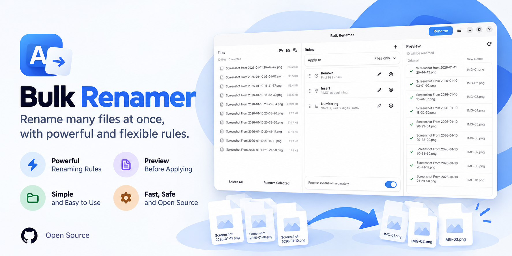

# Bulk Renamer

Rename lots of files at once — with a live preview, so you always see the
result before anything changes, and undo if you change your mind.

**Made for Fedora with the GNOME desktop (tested on Fedora 44).**



## What it can do

- **Preview first** – every new name is shown next to the old one before you rename.
- **Mix and match rules** – replace text, change case, add numbers or dates,
  remove or insert text, tidy up messy names, turn Greek or Cyrillic letters
  into Latin ones, and more. Stack as many rules as you like.
- **Undo** – undo and redo, plus a history of past renames you can roll back one batch at a time.
- **Safe** – name clashes are caught before renaming, and an interrupted rename can be restored.
- **Photos and music** – put the date a photo was taken or a song's artist and title in the name.
- **Presets** – save your favourite set of rules and reuse it later.
- **Translations** – partly translated into Arabic, Chinese, French, German,
  Greek, Hindi, Italian, Portuguese, Russian and Spanish (the rest stays in English).

## Install

1. Download `bulk-renamer-1.0.0-1.fc44.x86_64.rpm` from the
   [latest release](https://github.com/christosdaggas/Bulk-Renamer/releases/latest).
2. Open a terminal in the folder you saved it to and run:

   ```bash
   sudo dnf install ./bulk-renamer-1.0.0-1.fc44.x86_64.rpm
   ```

3. Start **Bulk Renamer** from the GNOME app grid.

To uninstall: `sudo dnf remove bulk-renamer`

## How to use it

1. Add files with the **Add Files** or **Add Folder** buttons, or drag them into the window.
2. Add one or more rules in the **Rules** panel.
3. Check the new names in the **Preview** panel.
4. Click **Rename**. Not happy? Press **Ctrl+Z**.

Press **Ctrl+?** to see all keyboard shortcuts.

## From the terminal (optional)

Presets also work without opening the window:

```bash
bulk-renamer list-presets
bulk-renamer preview --preset "Lowercase All" ~/Pictures/Holiday
bulk-renamer apply --preset "Lowercase All" ~/Pictures/Holiday
```

`preview` only shows what would change; `apply` asks before renaming.
Run `bulk-renamer --help` for all options.

## Build it yourself

```bash
sudo dnf install cargo gcc gtk4-devel libadwaita-devel gettext rpm-build
./scripts/package-rpm.sh
```

The finished RPM is written to `dist/rpm/`.

## License

MIT — see [LICENSE](LICENSE).
